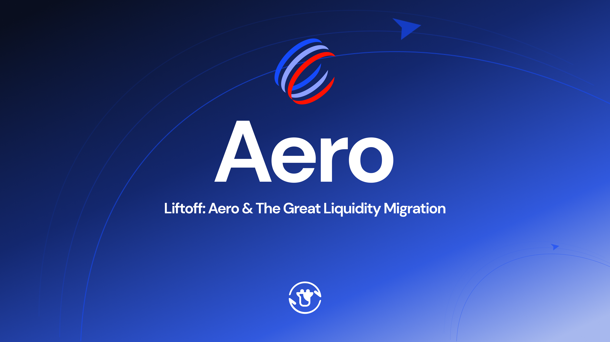

Aerodrome and Velodrome are preparing to become Aero. The long-anticipated merger is scheduled for **22 October 2026 at 00:00 UTC**, bringing the two protocols together as Aero expands onto Ethereum, Arbitrum and Robinhood Chain.

As Aero prepares to usher in a Great Liquidity Migration, Beefy will be among the first to migrate. For Beefy users in Aerodrome and Velodrome products, the migration of your position to Aero will take place over the coming weeks, supported by free Zaps. This article sets out everything you need to know about the migration.

## Aero

Aero describes its ambition as the [“unified liquidity layer for all of Ethereum”](https://aero.xyz/articles/aero-launch-update-all-systems-go/). Its seven-chain launch brings Ethereum, Arbitrum and Robinhood Chain alongside Base, OP Mainnet, Arc and Ink under one protocol. The aim is more than a larger deployment list: connected liquidity and cross-chain swaps are intended to let markets on one chain serve trading activity from across the network. [Aero Lite on Arc](https://aero.xyz/articles/aero-lite-is-live-on-arc/) already offers a lightweight deployment, set to join the full protocol and economic system at launch.

The pools themselves are getting an upgrade too. Aero's [Slipstream concentrated-liquidity design](https://aero.xyz/articles/the-aero-economy/) directs AERO rewards to liquidity at the prices where trades are actually taking place. Its upgraded fee mechanics include Dynamic Fees that respond to market conditions and, where enabled, an MEV tax on trades that pay for priority execution. These changes are designed to make liquidity more productive and capture more value from the trading it supports. This is a change to how the exchange works, not simply a new name above the same pools.

[Predictive Allocation](https://aero.xyz/articles/aero-predictive-allocation-faq/) changes how rewards reach those pools. Instead of relying on the old weekly reward cycle, Aero is introducing a more responsive system in which allocations can change during the week and rewards stream to pools. Aero's goal is to direct liquidity toward markets as demand develops, rather than always waiting for the next cycle to catch up. For a new pool, that could mean receiving rewards sooner—but it does not mean every pool will have emissions from the moment it opens.

## The Great Liquidity Migration

Bringing two established exchanges into one new protocol means moving more than a name. Existing AERO and VELO give way to a new AERO token, legacy reward emissions end, and liquidity needs to find its way into new pools. As [Aero's launch hub](https://aero.xyz/aero-upgrade/) explains, not every legacy pool will have a matching destination at launch. Across the migration, pools, reward gauges and the products built on top of them need to be brought into operation together.

For existing Beefy positions, the important consequence is a handover period. Where emissions have ended, the affected products are no longer earning yield unless that yield is distributed externally by Beefy or Merkl. We know that is an unwelcome interruption. The objective is to promptly and smoothly migrate your capital into the next-generation product once all the necessary economic and safety checks are complete. We won’t rush out replacements before they’re properly ready just to speed up the migration.

The scale of this migration means setting up all the new pools and gauges properly will take time; this will not be an overnight fix. An Aero pool can’t go live on Beefy before its gauge—the mechanism that enables its rewards—is added, and emissions can follow later still. Predictive Allocation may reduce the wait associated with the old weekly reward cycle, but we still expect delays. Even once a pool is live on Aero, it needs sufficient total value locked (TVL) and sufficient fees or rewards to compound, along with completed testing, to meet Beefy's rigorous deployment standards. A pipeline of products will form as each moves toward readiness, rather than every replacement arriving at once.

## Aero on Beefy

To help guide users through the migration process, we’re releasing a selection of updates to our frontend. From today, watch out for the following tags on existing Aerodrome and Velodrome products:

[`MIGRATE SOON`] means that emissions have ended and Beefy has paused the old product to stop new deposits. A new product has not yet been deployed, and so there isn’t yet a defined pathway to migrate. All funds remain available for users to withdraw at any time, but staying in the vault will mean a free migration once the new product is ready.

[`MIGRATE`] means that the equivalent Aero product is now live and open for deposits. Existing Aerodrome and Velodrome users will then be able to access the Migrate tab in the app and move their funds from the old product to the new in one click.

Both tags will be visible only to existing users on their old products. Withdrawing removes the tagging and excludes your deposit from the free Zap offer.

Migrations are handled by Beefy’s Zap V4 engine, which enables seamless vault-to-vault Zaps in just one click. Beefy is offering fee-free Zaps to existing users who do not withdraw, meaning Beefy will not charge any of the usual swap and bridge fees. The only costs to users will be gas fees and any slippage or price impact on assets swapped in the Zap. Free Zaps are provided on the same chain only, though paid crosschain Zaps will also be available on supported chains.

We're making every effort to migrate products as quickly as possible. There are many to work through, and the dependencies above mean wait times will vary from one product to another. If you have questions or requests about your position, please raise them in the [Beefy Discord](https://beefy.finance/discord).

## Liftoff

Aero is setting out to bring two protocols into a broader liquidity network, with upgraded pools and a reward system designed to respond more quickly to changing markets. Delivering that change means a substantial migration that will take time to complete.

For Beefy, the migration is an opportunity to develop our product, expand our Aero coverage to new chains and flex our ease-of-access tooling. By expanding our frontend to walk you through the process and offering free Zaps to get you there in one click, Beefy is helping make the migration as seamless as possible for all our Aerodrome and Velodrome users. It’s time for liftoff!

[Explore Aero products on Beefy](https://app.beefy.com/?platform=aero), and check your existing Aerodrome and Velodrome products for the `MIGRATE` tag when their replacements are ready.

[Aero](https://aero.xyz/) | [Aero Launch Hub](https://aero.xyz/aero-upgrade/) | [Beefy on Aero](https://app.beefy.com/?platform=aero) | [Beefy Discord](https://beefy.finance/discord)
