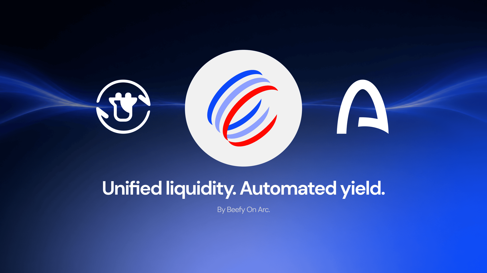

The internet revolution changed the world by unlocking seamless communication, unlimited collaboration and unified information across natural borders. It was so impactful that commentators often overlook the fields that remain constrained in its wake. Economic activity, for one, is still siloed across a patchwork of separate systems, controls and limitations. The world continues to wrestle with hundreds of incompatible financial systems, leaving users to carry the burden of complexity between them.

Smart-contract platforms offer a way to bring the internet's benefits to fractured economic systems: a universal protocol for managing shared state, decentralized consensus to establish trust in transactions, and openness to applications of all kinds. The vision is an economic operating system (**OS**) that provides a common foundation for financial applications to interface more seamlessly. Not one application replacing finance, but shared programmable infrastructure on which different applications can connect.

The challenge so far is that most blockchains have evolved as grassroots ecosystems, with applications built by and for their native users, while the parallel world economy rumbles on largely unaware. Building a true economic OS requires an interface between those worlds: infrastructure able to engage with longstanding economic systems and bring them forward. This is why we at Beefy are taking an early bet on [Arc Network™](https://www.arc.io/), by bringing the power of automated liquidity management to a foundational system that institutions and traditional financial systems can truly interface through.

## Arc

Arc is an open, neutral network built around stablecoins and financial applications. The broader platform connects apps, assets and developer tools through shared settlement infrastructure. Its stablecoin-native design starts with **stablecoins as gas, starting with USDC**: one USDC balance supports both gas and application transfers, with no separate wrapping step. Arc also implements native USDC transfer logging through [EIP-7708](https://eips.ethereum.org/EIPS/eip-7708), a planned future Ethereum upgrade. The [Arc Docs](https://docs.arc.io/arc/concepts/stablecoin-native-model) explain the implementation in more depth.

Payments and currency exchange are central to that direction. Onchain foreign exchange, or FX, means exchanging between stablecoins denominated in different currencies. It gives the shared-infrastructure thesis a concrete purpose: applications can send, receive and exchange money within a programmable environment. Currency exchange needs liquidity, and liquidity providers need a way to participate in those markets. That connection makes a financially focused network a natural setting for DeFi, rather than a separate world reserved for institutions.

The same programmable foundation is relevant to software-driven activity, including AI agents making payments within defined policies, while tokenized assets are another part of the broader platform vision. The immediate connection is the markets that support this financial activity and the opportunity to participate beyond holding or transferring assets. Payment services, trading venues and liquidity-management tools each have their own role; the economic-OS ambition is to let them connect.

## Beefy on Arc

To kick things off, Beefy has deployed our proven automated liquidity management solution — CLM — to Arc across Aero and Uniswap. CLM handles the process of earning through liquidity provision, with passive range adjustments and reward harvesting across the life of our products. Through Beefy, users can access exciting new opportunities in the same form factor and interface they know from other chains, alongside ease-of-access tooling like Beefy's industry-leading Zap deposits and withdrawals.

Today, we announce the launch of Beefy's new Aero products, premiering on Arc first and foremost. Arc is the first deployment for the new Aero protocol, debuting its new contracts through a [Lite deployment](https://aero.xyz/articles/aero-lite-is-live-on-arc/) focused on concentrated liquidity without emissions. To bootstrap the launch, Aero has partnered with Merkl to distribute incentives on its products, and Beefy is ready to compound both Aero trading fees and Merkl rewards from day one.

On top of Aero, Beefy already offers **[Uniswap V3](https://uniswap.org/)** CLM products on Arc. Where Aero is focusing on incentivized yields for bluechip assets, Uniswap's open approach has drawn significant usage from early projects on Arc, leading to many smaller products and pools for Beefy to integrate. Community tokens like **[$COOL](https://usdcis.cool/)** and **[$TOLLY](https://tollylabs.com/tokens)** are early examples of native assets that users can discover through Uniswap on Beefy.

## Get Me There

New to Arc and not sure where to get started? Don't worry, we've got you with our step-by-step guide to accessing and embracing the new platform:

- **Docs:** start with the [Arc Docs](https://docs.arc.io/) for network information and current details.
- **Gas:** you need USDC on Arc for gas; it is the network's native gas token.
- **Bridge:** explore [Jumper](https://jumper.exchange/), [CCTP.to](https://cctp.to/) or [Across](https://across.to/) for supported routes into Arc.
- **Explorer:** use [Arc Explorer](https://arc.etherscan.io/) to inspect network activity, transactions and balances.
- **Ecosystem:** browse the [Arc ecosystem page](https://www.arc.io/ecosystem/) for applications and services.
- **Trading:** explore [Aero](https://app.aero.xyz/swap) and [Uniswap](https://uniswap.org/) for pools and swaps, or [KyberSwap](https://kyberswap.com/) and [Matcha](https://matcha.xyz/) for swap routing.
- **Beefy:** explore the [Arc tab in the Beefy app](https://app.beefy.com/?chain=arc) for CLM products, and zap in and out of products in just one click across 9 supported blockchains via Beefy Zap V4.

## An Economic OS For The Internet

The internet broke down barriers to information and collaboration. It's time we demanded the same ambition for finance. Better financial systems should connect across borders, give builders a common foundation and stop leaving users to navigate the gaps. Getting there means bringing the existing economy into an open, programmable world—not building another isolated ecosystem alongside it. Arc is an opportunity to pursue that vision, and one we believe is worth building for.

At Beefy, we're helping make that dream a reality by showing what open applications can do on a shared economic OS. By contributing powerful automated liquidity management to an already-flourishing ecosystem of institution-ready applications, we can help turn the economic OS on Arc from hopeful ambition into the kind of interconnectivity we should always have expected from internet-enabled economies.

Explore the Arc tab in the [Beefy app](https://app.beefy.com/?chain=arc) and find our available CLM products.

[Arc](https://www.arc.io/) | [Arc Docs](https://docs.arc.io/) | [Beefy on Arc](https://app.beefy.com/?chain=arc)
