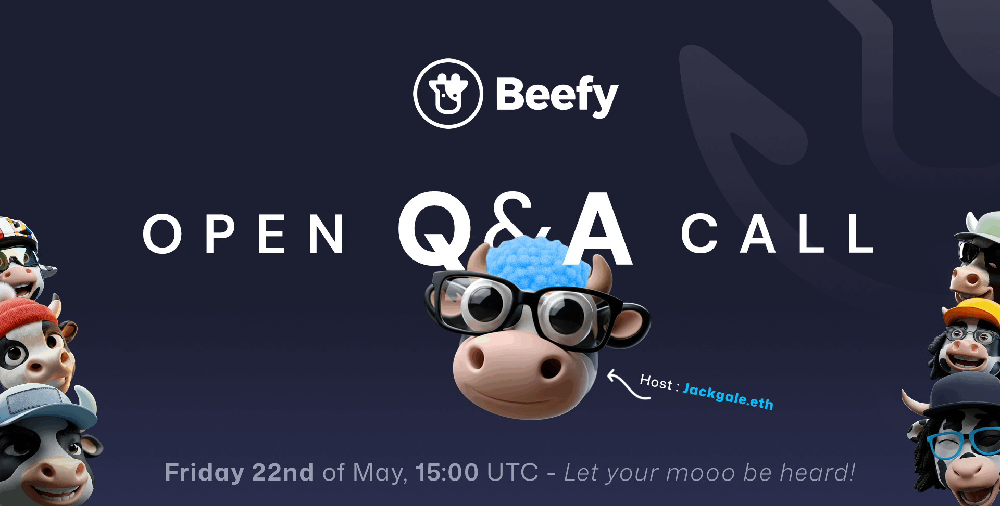

Beefy's second Open Q&A event was held on 9 October 2026 on the [Beefy Discord Server](https://beefy.finance/discord). As with [the first session](openqna1.md), the floor was open for cowmoonity questions, hot topics and feedback on Beefy's progress.

Readers submitted questions and discussion topics through a poll. Below, we’ve reproduced them alongside the contributors’ verbatim answers.

If you're excited for the next one, feel free to post your comments and questions in the #-general channel on the [Beefy Discord Server](https://beefy.finance/discord), where we'll start to share more about our next event.

## Stocks

### 1. [Yolo] Are any single-asset stock products on the horizon?

**GPMS:**

> It's definitely something that we had on our radar, but it depends on having the right pools and enough liquidity on chain first, which is what I think Base and Robinhood, which are the two biggest tokenized stocks movers are waiting first. So as soon as the market is there for single stock products and correlated stocks LPs, I'm sure will be there giving their support and having those products available for the Beefy users.

**Jack:**

> The key products that you tend to see for single assets are usually lending markets, sometimes also bridges. They're a little more complicated to set up than liquidity pools. You need to have oracles and be able to liquidate bad debt. So that's why they've been slower to get around to those. We've got some stocks on our platform at the moment, but they've not got any yield attached to them, so there's nothing for Beefy to compound.
>
> But we're pretty confident that's going to change in the coming months.

### 2. [Yolo] There are already some correlated stock LPs. Are any more coming?

**GPMS:**

> I was going to say that obviously depends on what the issuers are looking for. I would say the rise of the Robinhood stocks was pretty fueled by the combination of memes and pairing it with real stocks. So that brought a lot of volatility to the market. But I would say that after it matures, obviously, and the stocks get more widely recognized around DeFi, we're going to get a lot more correlated products and products for people who want to actually hold the stocks.

**Jack:**

> I agree with that. The more of these stock products you have, the more opportunities there are for correlated products. There is also nuance about whether it is efficient to have a correlated pair or to swap from other assets. At the moment on Base, all of the tokenized stocks are paired with USDC in 0.05% pools. That is super cheap to swap through.
>
> There's a lot of liquidity. So people aren't really that concerned about trying to create other pairs because we already have great liquidity. Whereas Robinhood, there were a lot more opportunities. And I personally was really excited about two correlated ones there. We did a gold silver pair.
>
> So both precious metals, but not totally connected. And then we did a BTC MSTR, so strategy, micro strategy. And both of those did pretty well. Got some good traction and some decent yield. But it's got to be liquidity that's not already super cheap to get to from elsewhere.
>
> This is where you can build really interesting correlated opportunities. I am constantly on the lookout for them. But as GPMS says, I think it is going to take some time for more integrations before we see more options.

## CLM

### 3. [$Stacker / 0x666] Some users say CLMs are not profitable because of high impermanent loss. What can be done to increase profitability, and would it be better to close pools that are not profitable?

**Jack:**

> So my interpretation of these questions was that they're focused on the user. Like how can we deal with problems with users not profiting because of impermanent loss? And if you do see that a pool is struggling with impermanent loss, it would be better to close it. And the way I look at this is CLM is a growing product. People are used to Beefy having a strategy that's been around for six years and that they know really well and they really understand and it's very simple.
>
> But when we stepped into CLMs and concentrated liquidity in general in 2024, it was an experiment. It was us pushing the boat out into something new, something that is more complicated and difficult. We had a long beta period followed by a big phase of incentives and bootstrapping. Then the markets became depressed and everything quietened down. Suddenly, we were seeing how CLMs reacted to sudden price swings and general downward sentiment.
>
> And I think the net impact of those early months and those early success was that a lot of people tried out CLMs. They were excited to. They saw early gains because of the incentives. But then when markets became bad, they didn't necessarily know. We maybe hadn't educated them enough about the risks of impermanent loss when you're dealing with concentrated liquidity.
>
> As a result, there were enough cases where CLMs were not generating the short-term returns that people wanted. People left their products without feeling they got what they hoped for. That is a shame, and it is on us in the way that we manage our CLMs.
>
> But at the same time, it's something where when the market is going down only, it can be very hard to beat that tide and give people a positive experience. And so rather than us continuing to push and just say that, CLM is as perfect as it is and there's no problem, we've spent a lot of time over the last two years trying to improve CLMs, learning how to pick the product that is best for a CLM. And also to identify products that maybe aren't going to benefit that much from having really actively managed liquidity. Maybe if they've already got really plentiful full-range liquidity.

**Jack:**

> It's also a bit about us learning what are really healthy and still profitable ranges, what deviation should be allowable to protect us from making deposits, and when we should reset the ticks of the position and harvest the position correctly. And all of those things have evolved a lot, particularly in 2026 as we prepared to launch on Ethereum. We've just gone back to the drawing board on some of these things and we've built new tools to be able to monitor them and to assess them. We've changed the way that we think about resetting ticks and harvesting. And all of these things have made CLMs, I think, better.
>
> They are producing more profits. And we look at things such as Robinhood recently where the entire chain has been totally CLM products. And we see the vast, vast, vast majority of positions are in profit and then stay in profit throughout the whole lifespan. Maybe sometimes they're a bit wider than we would have done previously. Maybe sometimes it's just because the market is moving upwards and not at a dramatic sudden rate.
>
> But in general, we're seeing that CLMs are performing really well at the moment on all the new chains that we're launching them on. So that's what we are doing to increase the profitability and ensure that high IL is less of a risk. We can't take away the fact that managing concentrated liquidity does mean more exposure to impermanent loss and that impermanent loss can be realised in the process of management. But where we're seeing the vast majority of positions being profitable, I think we're getting closer towards what we want to do. And I think the final limit of that question, whether it's better to close pools that aren't profitable, I completely agree.
>
> If we see something that's just not working, we've picked a token that's really, or a pair that's really safe. We've gone for a really narrow range, it's just not generating enough yield. But yes, we are fast to end of life it and take it off. But I think what people often say about CLMs is, why is there a WETH USDC pair from a year ago that's earning 1%? Why are we continuing to operate that?
>
> Often, that is because people have been in a product for a long time, built up a position steadily and accrued profits, and do not necessarily want to exit or chase the highest possible yield. Our point of view is that, so long as a product is not clearly causing harm, we are happy for people to sit in products that may not be as profitable as other options. We will always try to promote newer, better products, higher yields and better opportunities for our users. But Beefy has always been a place with a thousand products, including many that have been there for a while, hold a large amount of TVL and may not look as attractive anymore.
>
> And I don't think that's going to change. What is going to change is we're just going to keep honing our process for managing concentrated liquidity and making this product better and more resilient in the face of hard market conditions.

### 4. [0x666] Could Beefy remove narrow-range products, display a warning about high IL, or filter for CLMs that are performing well?

**Jack:**

> I mean, one person's narrow is another person's wide. So it's subjective to decide what you think is too narrow. But in general, I would say the way that we think about this is not like, "Ooh, the range is too narrow. We've got to remove that product." It's the range is too narrow. We've got to widen that range.
>
> We have the ability to do that. That is part of offering an effective product. And so, there have been times when you have a new token and we just put it a little bit too wide and we see it going a little bit too close to the edge. And these days, all the strategists are watching their products and reacting quickly and they're getting things right sized after a couple of days within launch. But I think back in the old days, it was harder to know what was the right range.
>
> So it's something we've gotten better at. The display warnings on the site, we do already display a warning for uncorrelated pairs. They're likely to suffer from some IL over time. But high IL, it is like basically staring into a crystal ball to say, "I think this is going to have high IL in the future." Before like a market collapse, I would say that like WETH–USDC shouldn't have high IL. But then the market collapses and, suddenly you incur a lot of IL.
>
> There are some meme coins that you think absolutely should have high IL. And then they perform in a very normal fashion despite your expectations. And so whichever way you go, by putting a prediction out there about impermanent loss, you're being a hostage to fortune. And I think whichever way it goes, no one's going to thank you if you're right, but people are going to criticize you if you're wrong.

**Jack:**

> So appreciate all the suggestions. We really value the feedback. But it's hard for us to point to a CLM product and say, that's definitely going to perform well, or that's definitely going to have a lot of IL ahead of time. In general, we try to avoid staring into the crystal ball, but just presenting you with the facts that we can.

### 5. [$Stacker] Can CLM Pools and CLM Vaults be merged to reduce the space they take up in the UI?

**GPMS:**

> I think it's a great question. Actually, that's something that we have in plans. I'll give a little bit of quick background for the people who might not know why actually they're separate. The CLM pools basically pay out rewards directly that people have to claim. and the CLM vaults auto compounds all the extra rewards back into the position. So our thing now is that we are exploring ways to basically show this more cleanly in the UI because at first, we thought that showing two different products because they actually are in the UI, like it didn't... like at the moment wasn't a goal for us for like how much cluttered the UI was going to be.
>
> So basically our plan now is show this more clean since it's a lot of feedback that we have really received and we value it. So we are basically working on a simpler, nicer experience for users and merging them also will keep both options while freeing up space. So our goal is basically making it more easier to navigate but it's still offering the two types of products to the users.

**GPMS:**

> I don't think we have a specific timeline, but it's been worked on like a hundred percent.

**Jack:**

> It's pretty complicated. I'm trying to merge the existing performance data of the two. You need to be able to go on that page and have positions either in the pool or in the vault and be able to see how both of them have performed and how that data marries up. So it's going to take a little time. It's been worked on for a while, but it will happen.

## Strategy & BIFI

### 6. [Builder Sharp / $Stacker] Has Beefy tracked autocompounding usage in recent years, including wallet numbers? With incentives not lasting forever, how will Beefy maintain revenues, and what makes the team think autocompounding will last?

**Jack:**

> So there's two kinds of stats that we do look at, I think everyone should look at, which is the internal and the external. So the external, we all have access to the same data providers. Beefy isn't paying a ton of money to get expert reports on the state of the industry, but we're looking at DeFi Llama, we're looking at CoinGecko and other sites that aggregate data about industry performance. we can see, that auto compounding had a massive heyday, after DeFi summer, but since then more new use cases have come across and stolen some of the DeFi total TVL. We can see that, we've still not returned back to peak TVL from that time period.
>
> And so in some senses, there has been decline in auto compounding. But we can also see that in 2026, TVL is on the up across the category. Beefy has outperformed competitors within the category. And I think beyond just base metrics like TVL, where you're just looking at static, where are we at now? A lot of auto compounding projects, a lot of liquidity management projects have gotten smarter, have issued new products, and have generated revenue from new sources.
>
> So the external, absolutely, we're monitoring it constantly. I mean, I have a good sense of what's going on in the industry. But the internal is what you talked about there, Stakius, like things like, have the number of wallets increased? We're not monitoring, competitors or others in the industry for the same. But we have fantastic data behind the scenes on our user base, users of every different Beefy product, and how those users are distributed and how their activities change over time.
>
> A big shout out there to Mr. T, who is the guru with uniting all of this data into our data barn project. And thanks to him, we have explorers where we can check in and see how the number of users are changing to answer Buildersharp's specific question. The number of wallets is actually always increasing. Strangely enough, it never really decreases for Beefy.
>
> And that's just because over time, you have more and more new users who tried out Beefy, had some small position, maybe not withdrawn it fully, maybe left something and then forgotten about it. And so, over time, it just grows and grows and grows. I think the last time we checked, we had about 150,000 different wallets that hold some active Beefy token. But I think we're interested in a narrower subset of those users who are actually moving their funds around and engaging with different products. And we do look at them and think about them as different groups.
>
> you have the stablecoin farmers who only stick to one protocol and move around a few different pools. You have the real yield farmers who are jumping into every new chain that comes along. So, there's a lot of different demographics that we can track with this data. But we keep it private for the most part just purely because it's useful for us. But maintaining it externally is a big cost that we don't need to bear necessarily.
>
> And we're always happy to answer questions about it. But I don't think we have any plans to open that data up or give detailed statistical reports on a regular basis from it.

**Jack:**

> Traditionally, Beefy auto-compounded governance tokens and incentive emissions. Many projects did not want to do that on their own platform because it would mean selling their own token to retail. That is obviously a bad sign; it immediately looks scammy. Beefy was a useful counterweight: projects could avoid selling their own token while still offering users a higher yield. Now, that business model has faded. It is still true of some DEXes, particularly ve(3,3) DEXes such as Aerodrome, where the protocol does not want to be dumping AERO.
>
> That's just like a no-go for them. But these days it's actually more about our liquidity management products because, because so much liquidity is moving into concentrated liquidity. And with that it's actually just because it's hard. It's really, really hard to develop a good concentrated liquidity management product and have it work over an enduring period of time.

### 7. [Builder Sharp] Does Beefy see autocompounding and LP management as viable ways to grow BIFI holder revenue and value over the next 1–3 years?

**Jack:**

> And to that, I would point back to our last session in May, where I gave a bit of a detailed talk about how Beefy has adapted and moved away from just auto-compounding incentives towards liquidity management. And that's really the direction that we see ourselves moving in. We've got a established brand name. We've got a big community, a lot of loyal users. And that's really a strong strength to take into a competitive space like liquidity management.
>
> And so we're really keen to just keep building on that foundation and to keep executing on a strong business model. Because we think that the day will come when everybody is wanting to provide liquidity and swap into new tokens again, rather than what we've had in the last couple of years, which is running for safety and choosing things that are very simple and easy. And so, that's what we're focused on. We're not always chasing the next shiny thing. And I think in terms of the next one to three years, unfortunately, broader, macroeconomic climates are impacting on our business model a lot.
>
> I don't know that in the next one to three years, things are going to change. Certainly, we'll have an election in three years that will probably have a big bearing on the global macroeconomic climate again and shake things up. But I think the world is struggling at the moment. There is more economic hardship than we've seen probably in the last almost two decades, the last financial crisis. And I think in a time of crisis and hardship, it's not a surprise, that people have less money to invest.
>
> The people are more wary about exotic investment products like you might find in DeFi. And for Beefy, our job is to protect this excellent business model and this great project that we've built and get it through to the point where the market is excited again. And they're looking for that trusted name who's got the credibility, who's got the experience, who's got great products. And we think that that is going to be the right model for those times. But until then, we just need to adapt.

### 8. [$Stacker] Is BIFI Pool/Vault APY a good metric for valuing BIFI?

**Jack:**

> No financial advice here, but I'll walk you through my thinking instead. But I know that it's definitely a school of thought. And when it comes to valuation, there's no right and no wrong. I think it's best to just take a few different metrics and compare. The reason that I don't think it's such a strong metric, at least anymore, is because the APY is a function of how much revenue was generated in the last couple of weeks, mostly in the last week, but sometimes with a bit of hangover from a couple of weeks before.
>
> And so if you've had a bad couple of weeks, or let's say something gets stuck in the bridge for some reason, a bridging provider is having a failure or something, you could find that the APY dips for a week or something rises the week after because there's more that's come through the revenue bridge. And in those circumstances, you would be materially changing your view on the value of BIFI based on one week's worth of activity when actually nothing in the underlying picture might have changed. So the way I like to think about it is the treasury that the DAO has is a baseline of the value that's attributable to each share, each token, each vote within the Beefy DAO. And that baseline is something that really like the value of Beefy shouldn't go below. But over and above that, the APY that it's giving back to you is the value that you can expect to accrue from that token from holding it over the next year.
>
> And so you should take that as a baseline and adjust it upwards based on how much you expect you'll earn from holding Beefy. And I would generally look over a longer period of time. I wouldn't just look at the last week, what the current APY is, but I would look over the last year and think about the trend in performance and then extrapolate out into the future based on that trend. But I think that starting with the APY is a good place to look. Starting with our treasury dashboard is also a good place to look.
>
> And for like really detailed financial analysis, look to the financial reports. Our quarterly financial reports.

### 9. [$Stacker] Is Beefy just focused on revenue, or will it add new products and tokenomics in the future?

**Jack:**

> For me, it goes revenue first, product second, tokenomics third. We need revenue to survive. If we don't keep up with our existing business model, we will drain the funds that we do have. We won't be able to keep talented people working for us and the project will stagnate and we'll struggle. So revenue is what we need to survive.
>
> That's the basic oxygen that we need in our system. New products is how we keep that revenue going long term. If we just sit on the same products forever, over time, we're going to lose our competitive advantage and fall behind the new generations of things that are coming out. So yes, we view product development as a priority, and we are actively working on it. I'm glad to show we've shipped, I think, two or three new strategies in the last month, and the pace of new strategies is growing.
>
> But also we are looking towards that next big milestone product that's going to really change the game. But as for tokenomics, unfortunately, I think it's quite a long way behind the other two in terms of a priority, and that's just because of the level of value that's being generated. We obviously talked about changing the tokenomics back in April, May, after the Binance delisting, and I know the community is obviously interested in changing the way the staking works and making the token a bit more attractive to the people who actively participate. But the problem, I think, with those changes is that you're basically just reallocating how the existing value flows from one group to another. You might be cutting off the people who aren't really paying attentionand increasing the value for those who are.
>
> That might increase the token price, it might get more people involved. But once you've had that initial pump on the basis of that change, and the market equalizes around the new normal, you'll find that the value hasn't really changed fundamentally that much, but you could have spent months and months chasing your tail, trying to find the right way to share the value, when actually the most important thing is just to keep generating that value. That, at the end of the day, is what I think token holders really want. I think it's why a lot of people hold Beefy, because they get that payment constantly. Constantly.

**GPMS:**

> I agree with all your ideas. I was going to say revenue, then products, and then tokenomics. Revenue, obviously, is our focus number one, because it's basically what keeps Beefy running. And also, it gets tied with the token a lot, as Jack says. Beefy is unique, and there's not a lot of protocols which the revenue affects directly on how the token behaves.

**GPMS:**

> And now the liquidity provision is moving to V4, which is something that we are well aware and we are working on ways to basically be able to cover that section of the market when the time comes. Right now, I would say that Uniswap V3 still dominates the market, but obviously as things are evolving, I would get my guess would be that V4 is going to be obviously the principal way that people like to provide liquidity in the future, and we have to prepare for that. And that's also something that directly ties the product with the revenue. So definitely the tokenomics are at the bottom of the list, but it's something that someday we could revisit and maybe rework to a point that everyone feels comfortable.

### 10. [$Stacker] If Beefy grows a lot, is a Binance relisting an option?

**GPMS:**

> Honestly, it's not something that we are actively looking to do or is actively on our to-do list to be back on Binance. Back when Beefy was first going to the market, it was around 2019–2020, which exchange listing at that time was a pretty big deal. In today's market I personally feel, and I know it's a, it's a feeling that a lot of the contributors have, that right now listing on a big exchange, centralized exchange, it doesn't carry the same weight that it used to do before because most of the activity now happens completely on-chain. So we really valued the listing at that time because it was a, I could say, natural listing because we didn't have to pay or anything. It was literally out of interest that they had in the Beefy protocol.
>
> And we also valued our relationship with them. But our focus right now is on building and growing the TVL and the revenue, as we mentioned in the past question. And I would say making Beefy as strong as possible to dominate on-chain.

## Sonic

### 11. [0xcb] What motivated the Sonic deprecation, and why now? Isn’t the chain preparing for a major comeback?

**GPMS:**

> Basically it comes down to the numbers right now. Uh, Sonic ecosystem doesn't have enough, opportunities for Beefy to make, uh, meaningful revenue. And people, believe it or not, uh, keeping vaults running, uh, on a chain has real cost for us, uh, also in, in other parts of, of our infrastructure, um.

**GPMS:**

> And right now, what I get for the sense on Sonic is that they are focusing more on business-to-business products, which isn't really like our area of expertise. it's users, Beefy users are retail and basically DeFi experience. So it's nothing personal or against Sonic. And if the comeback happens, we'd love to see it. We had some great times with Sonic and new exciting products that we did, the liquid staking.

**GPMS:**

> So we basically remain good partners. And we are always happy to go back to the chain if it actually makes the greatest comeback of all times, which we are happy if that occurs. But it's basically the lack of opportunities right now for us to make sense of the effort and resources that you put into a chain to keep it alive.

**GPMS:**

> We have been really structured after a time on deploying on chains because obviously it's a very important part of our job since we stay like basically on top of every opportunity and every new chain that comes online. So having done Sonic previously, I'm pretty sure it will be, I wouldn't say pretty easy because it's not something that I will personally do, but I think for the devs it will be pretty easy going to just redeploy into the chain.

## Stream

### 12. [3K] At what stage are we currently? Are there estimated timescales or upcoming steps?

**Jack:**

> So the formal answer to this is quite disappointing. I think people really need to get that in their heads. Formally, in a legal sense, we have not entered any formal legal resolution process here. We are not in formal bankruptcy proceedings. there is not a lot of outstanding civil lawsuits that are coming to trial at any point soon or criminal proceedings against the founders.
>
> There is not, in the law's eyes, a process with a deadline coming up soon.

**Jack:**

> And I think that is a bit of an upsetting realisation for people who just want some justice. But the reasons for that are good, I think. And it's important to dive into them. So Stream have done what they can to try and manoeuvre through this situation without putting it into the courtroom and making it subject to a lot of specific legal rules in the jurisdiction that they're based in, which will complicate the situation, slow things down and make it more expensive. So they've created a company called Stream Soft Holdings.
>
> And they've basically tried to retrospectively wrap up all of Stream's operations into that company, which means all of the claims and all of the liability belong to that company rather than personally to the founders. Now, that's extremely messy. That doesn't work perfectly. I'm not saying that the founders are now free of any liability. But it does at least make very clear who we're dealing with and what process we're going through now.
>
> And Stream Soft has now been able to appoint professional advisors who we're dealing with and we have good interactions and relationships with. And now we are looking at how Stream Soft can work through the problems that it's facing. And the advisors have been very clear to me. The problems that they're facing is the outstanding liabilities slash debts that Stream has incurred to all of their users. Their sole focus at the minute is to basically make those liabilities go away by distributing assets to them at some stage.
>
> I don't think there's any illusions that Stream has the money to pay off their debts and to keep going. They haven't released details of their financial position. But to me, it's very clear that this is an insolvency. Stream is being gradually wound up with all of their liabilities resolved gradually.

**Jack:**

> Now, onto the speculation. I believe that Stream are trying to keep this out of court using mechanisms under US law which allow them to distribute assets to the creditors and stakeholders so long as none of them complain to the courts and raise them out to the courts. And that's why there's no proceedings. That will help to keep things cheaper. It will help to hopefully make things a bit faster.
>
> But it also means slightly less protection for the creditors and stakeholders. And so going through that mechanism, we're not going to get a lot of formal deadlines here. We're not going to get a lot of external parties deciding how this matter gets resolved. Instead, we have to all work together with Stream to try to get those funds distributed or somebody has to raise it as a bankruptcy and take it to court. So doing this involves basically a lot of conversations behind the scenes and a lot of working out the maths to understand how to distribute fairly so that everybody is happy and no one complains to the courts and this all gets sorted out in good time.
>
> So that's what I understand the advisors are doing right now. They are having these conversations with different participants. We're one of them. And what will happen is they will gradually come to a point where they think that their data is good enough and they think enough of the large stakeholders are on board that they will then be able to announce the plan for distribution. And hopefully no one complains and it gets finalized and dealt with.
>
> But there are still quite a lot of steps to go. I don't think that this is going to happen very soon. The next step they've told us about is this process of reconciliation. And that's basically taking the user data that users submitted in the information form and combining it with the data the stream has and also the data on chain. And I think this is probably going to take a few months.
>
> In some cases they're going to be dealing with lots of different individuals one-on-one. And that's going to be very inefficient. And it's going to involve a lot of information being shared to demonstrate the truth of things. In our case we have made clear that Beefy should step forwards and offer as much assistance as we can. To help the reconciliation process with a view that any user who doesn't want to be involved and doesn't want to hassle the reconciliation process should have all of the work done by Beefy wherever possible.
>
> But the users who want to step forward and represent themselves can absolutely do that. Beefy doesn't have to be involved with them at all if they don't want to. And their advisors really enjoy this idea. They think this is the right way to go. And so we're going to sign an NDA with them.
>
> And then we're going to start talking about how we can help with the reconciliation. And once we're in that sort of situation and we have a bit more knowledge we can push them to give more updates. Which is what we were trying to do with the last call. And we can definitely give more updates to you guys ourselves. But I think this is probably going to be a process of at least six months to get from a broad set of data that hasn't yet been pulled together and finalized to a set that's ready for distribution.
>
> I'm not saying in six months I think it will be distributed. But I'm saying at least six months for the process to continue before they could possibly get to a phase of distribution. And I think the worst case scenario is that this could take a couple of years. So six to 24 months.

### 13. [Leviathan] What percentage of funds has been recovered? When can users expect their funds back? Will Beefy cover any remaining loss?

**Jack:**

> So what percentage of funds have been recovered? People watching on chain have seen a good portion of the assets in public wallets liquidated. And so that does give us hope of like an initial base level percentage. There are still assets, locked up in DeFi protocols needing to be liquidated. With people watching the value just gradually drain out of them.
>
> But there is a good amount there that has been recovered. I'm not going to speculate on a percentage because this changes all the time. But, we are talking about serious money available for recovery. What I would say, though, is that on chain is not the whole story. When Stream initially disclosed the loss, which triggered their current insolvency situation, they made clear that this was an off-chain loss through trading on an exchange.
>
> The problem with that is that it is possible that they could have liabilities off-chain or, that we don't even know of. Money that they could have invested could have been borrowed through debts that aren't collateralized. And so when you're dealing with insolvency, you basically need to line up all of the different debts on chain and off-chain. And all of the different assets on chain and off-chain. And you need to understand the difference between the two.
>
> And unfortunately, it is entirely possible that what we see on chain could end up being reduced by what is going on off-chain. Also, there will be expenses of having lawyers and financial advisors coming through all of this and people working to distribute this. So the number is probably only going to go down. But with that said, I want to give people a bit of hope here that I don't think we're scrapping around for one cent on the dollar. It's just not necessarily going to stay at the initial amount that we see on chain.
>
> And to respond to what Perrin said there, there is definitely still a strong possibility that Stream will file for bankruptcy. And if they do, then this will be distributed through the courts and the amounts will be made public.

**Jack:**

> There was one last part of that question. Will Beefy cover the remaining losses? I just want to be really strong and clear on this. Absolutely not. I'm to be the bearer of bad news, but Beefy does not offer covered products.
>
> We do not offer a guarantee when people come to use products on Beefy that they will not suffer any loss. If we did, we would be out of business pretty much immediately. And there have been so many things that have happened on DeFi over the years in this experimental industry that if we took any other approach than saying, I'm that the investors make the decision for themselves, then we would not have survived as a business. So it's horrible to see users losing out. It's unfortunate.
>
> But if Beefy is not at fault, then we are not intending to cover any of the loss. And that is always going to be true for us. That said, we will obviously be putting in the labor and the hours to help our users to ensure they have a good experience. So they know that using Beefy is not just completely hands-off and you get no support whatsoever. But taking responsibility for it and making up the difference is just not a way to run a business, unfortunately.
>
> And it's part of the reason that DeFi is cheaper and more efficient is that you're dealing with protocols and not with banks who are bearing the legal liability to protect their users from any harm. Unfortunately, that's just how it is.

### 14. [3K] What are the risks for affected users, and what should they do at this point?

**Jack:**

> Well, right now the users have a claim, and that claim has a value attached to it. So, they may have lost $1,000, but they may think they've got $500 worth of claim. And so, they're trying to, they should be trying to conserve that claim and help to deliver it into some financial value because that is their route to some recovery.

**Jack:**

> So I think there are absolutely risks for affected users to be aware of, and I'm glad to speak quite candidly about them. The biggest risk is that you are unable to participate in a recovery process because you're not engaged or because the process is seeking to exclude you. So if you are not paying attention to what's going on with Stream and you have a claim, if you're not submitting the information form, and if you're not thinking about whether or not you're going to be eligible to claim, then you absolutely need to be doing. You need to be checking in, I would say, at least every month to the Beefy Discord or to any other Discord or community spaces that are discussing the products that have been affected. you need to make sure that your name is being included, your address is being included wherever possible.
>
> We will help you with that, assuming you're a Beefy user. But you can't unfortunately just expect to sit back and have this delivered. And I've got to say, I don't think that this distribution process is going to be like some of the other ones we've seen on chain, where the party hands over a big pile of money to someone like Beefy, and Beefy distributes it. And no one ever has to verify anything. It just appears in your address as an airdrop.
>
> I actually think in this case, they're going to expect to verify the people who are receiving the funds. And I think that there may be some legal regulations that impact who they can give money to. One example of that is we had, I believe, an Iranian user of Beefy in the Discord a while ago saying that they were affected by Stream and they hadn't realized that this would be a US set of proceedings. But obviously there are sanctions from the US against their banks. Are they going to be able to claim?
>
> And those sanctions don't necessarily exist against every individual or every user in the sanctioned country. But it does make things a lot harder. And so, yes, I think there is a risk that you could be in a country that the US will not deal with. And you could present yourself to claim your stream debt. the things that are owed to you.
>
> And you could find that there are difficulties there. So I think if you're in that position, come forward to us. Now that we're signing an NDA and we're speaking regularly with the advisors, we will put those questions forward. And we will try to give people clarity as soon as possible. But I think there are still risks in this process.
>
> You don't need to do much. But I think you do need to pay attention once every month or so. And you do need to make sure that you are showing up and your name is on the list. We will do as much of the rest as we can for you. But unfortunately, users who disappear off and show up six years later wondering where their money is may be in for a nasty shock here.
>
> Because this is a different process to what we've seen before in DeFi. .

**Jack:**

> I'm not certain exactly how the distribution is going to happen.

## Aero

### 15. [Winsa] What does moving BIFI–WETH liquidity from Uniswap to Aero mean? Why switch, and does it affect rBIFI and mooBIFI? What led to the decision?

**GPMS:**

> The big driver here for us is Better Incentives for our POL, which is our protocol-owned liquidity. On Uniswap, the liquidity only earns basically trading fees. And on Aero, it earns the emissions. So the same liquidity basically gives us more revenue, which is in turn used to provide more liquidity. And also from a BD point of viewing things, it's a strategic move with us because it aligns us more with a good partner, which we have collaborated with them extensively.

**GPMS:**

> We also have worked closely with them on Base, on OP, which is Velodrome, which now will become obviously only one protocol.

**GPMS:**

> And yes, now they'll deploy on various different chains, which also we hope to collaborate with them. on the point of mooBIFI and rBIFI, the core functioning of the tokens doesn't change. So it's basically a liquidity move that doesn't interfere with how they work today.

**GPMS:**

> Not exactly since that's what will move. It's the protocol liquidity for the BIFI and mooBIFI tokens. So those rewards are basically used to add more liquidity, but it doesn't reflect on something that the user holding the token will receive. unless you obviously provide liquidity for yourself, which our hope is that the rewards, yes, is going to go up. But in terms of the position that's going to be moved from Uniswap to Aero, it doesn't really affect the users as a Beefy token holder per se.

**Jack:**

> Maybe one thing to add as well is that the Uniswap pool doesn't get deleted and removed. And we'll actually still keep some liquidity there just to keep it ticking along. So if you prefer Uniswap and you still want to provide liquidity for Beefy, that won't change. But adding a second venue that has the ability to issue emissions onto the token and taking part in this exciting launch from this probably going to be quite a lot of activity, we just see it as a net-net positive for Beefy. We wanted to support our partner, take part in something exciting and seize the opportunity.
>
> It's definitely not a choice of one type of liquidity being better than another or saying that we're only ever going to use one type of liquidity. We're always trying to offer the best experience for people who want to buy and sell Beefy.

